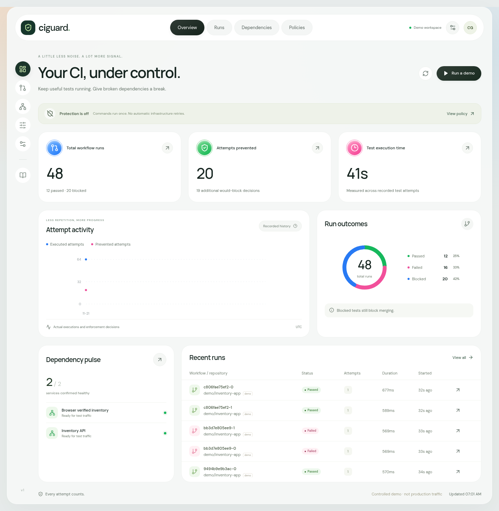

# CI Guard

**Stop repeating expensive tests against a confirmed broken dependency.**

CI Guard wraps a test command, coordinates a shared retry allowance across jobs, and reports exactly why a run passed, failed, or was blocked. Self-hosted Flagsmith supplies enforcement and retry policies. A React dashboard shows recorded evidence and provides a controlled demonstration.

> Blocked tests do not pass. Configure the wrapper's job as a required GitHub check. Never add `continue-on-error` or skip the required test gate.



## What is included

- Python command runner and reusable GitHub Action.
- FastAPI coordinator with transactional SQLite retry accounting and idempotent submissions.
- Live Flagsmith policy evaluation and repository targeting.
- Administrator-managed GitHub connections, selected repository projects, real workflow activity, and project-scoped runner credentials.
- Overview, run history, attempt details, dependency health, policy controls, and setup UI.
- Self-hosted Flagsmith/Postgres Compose deployment.
- A controllable inventory service and real pytest demo.
- Unit, concurrent execution, subprocess, and integration checks.

This is a single-organization self-hosted deployment. Run **one coordinator replica** with SQLite on local persistent disk. See [architecture](docs/superpowers/specs/2026-11-21-ci-guard-design.md) and [operations](docs/OPERATIONS.md) for boundaries.

## Quick start

Requirements: Python 3.12+, Node.js 22+, npm, and Docker with Compose. Linux is the supported runner platform.

```bash
./scripts/setup.sh
```

Setup installs the locked dependencies, builds the web app, starts self-hosted Flagsmith, and creates the four policy flags. Credentials are generated once in ignored `.local/runtime.env` and `.local/flagsmith.env`; reruns preserve existing credentials and policy values.

Start the full application:

```bash
docker compose --env-file .local/runtime.env up -d --build guard
```

Open CI Guard at `http://localhost:8080` and Flagsmith at `http://localhost:8000`. The CI Guard Settings screen accepts the administrator token from `.local/runtime.env`. Enter it locally; do not paste it into chat or commit it. Flagsmith login email and password are also in that private file.

The default Compose ports bind only to loopback. To use external CI runners, deploy behind an HTTPS reverse proxy on a network reachable from those runners. Do not expose the unauthenticated demo service publicly.

## Controlled demo

Run the coordinator and inventory service with explicit demo mode:

```bash
CI_GUARD_DEMO_MODE=true docker compose --env-file .local/runtime.env --profile demo up -d --build guard inventory
```

Demo mode enables demonstration controls and unauthenticated local use. **It is for local demonstrations only.** When a Flagsmith key is configured, policy still comes from the real Flagsmith instance. The UI labels demo runs; it does not present them as GitHub-hosted executions.

1. In Policies select **Observe**, with two retries per job and a shared allowance of two.
2. In the Overview demo panel run **Dependency outage** with four jobs. Inspect actual attempts and would-block decisions.
3. Switch Policies to **Enforce**, then repeat the outage. The jobs share one allowance.
4. Restore the dependency using **Healthy**. If cooldown has not expired, read the report and use the dependency probe once eligible; rerun after recovery.
5. Run **Assertion failure** with the healthy dependency. The assertion remains a failure and is not retried as infrastructure trouble.
6. Run **Healthy** again. Actual test execution must pass before the run is green.

Observe is not proof of savings. CI Guard records execution seconds, actually prevented attempts, and would-prevent decisions separately. It does not invent dollar savings. Standard GitHub-hosted runners for public repositories are generally free; use an explicit applicable rate if estimating private-runner costs.

## Local development

After setup, start the example dependency and application in separate terminals:

```bash
.venv/bin/python examples/inventory_service.py
CI_GUARD_DEMO_MODE=true .venv/bin/python scripts/serve.py
```

For live UI development, start `npm run dev` in `web/`; Vite proxies `/api` to port 8080. `scripts/serve.py` serves `web/dist` after a production UI build. Local secrets are loaded without printing values.

Run all checks:

```bash
.venv/bin/python -m pytest
cd web
npm run build
npm test
```

For a running local demo with real Flagsmith, run `.venv/bin/python scripts/verify_demo.py`. Optional browser checks use `python scripts/browser_smoke.py --chromium /path/to/chromium` after installing Playwright in that Python environment.

The example intentionally failing scenarios are not part of the passing unit suite; the demo invokes `examples/test_inventory.py` explicitly.

## GitHub Action

Use the dashboard's Projects screen to connect GitHub and prepare repository-specific setup. [GitHub connection instructions](docs/GITHUB.md) cover GitHub App registration, selected repository access, token permissions, and external runner connectivity. One team workspace can connect multiple repositories; this is not a public multi-tenant login service.

After pushing this repository, pin the action to a reviewed commit SHA. Register a dependency in the dashboard before using it. Store the runner token as `CI_GUARD_TOKEN` in GitHub Actions secrets. Keep administrator and Flagsmith credentials on the coordinator only.

```yaml
name: Integration tests
on: [push, pull_request]
jobs:
  guarded-integration-tests:
    runs-on: ubuntu-latest
    permissions:
      contents: read
    steps:
      - uses: actions/checkout@v4
      - uses: actions/setup-python@v5
        with:
          python-version: '3.12'
      - run: python -m pip install -r requirements.txt
      - uses: ayushmanthehero-lab/toggle_wars@REPLACE_WITH_REVIEWED_COMMIT_SHA
        with:
          server: ${{ vars.CI_GUARD_URL }}
          token: ${{ secrets.CI_GUARD_TOKEN }}
          dependency: inventory-api
          command: python -m pytest tests/integration -q
      - uses: actions/upload-artifact@v4
        if: always()
        with:
          name: ci-guard-report
          path: ci-guard-report.json
          if-no-files-found: warn
```

The `guarded-integration-tests` check must be required in branch protection or repository rulesets. An earlier failing step, missing secret, wrapper error, or blocked test remains non-successful. Fork contributions do not receive repository secrets by default; use an isolated coordinator/test setup without production credentials. Never run untrusted pull-request code with privileged `pull_request_target` secrets.

See [the action contract](action.yml) for exact inputs. The command is split into an argument array; shell operators such as pipes are not evaluated. For complex commands, commit a script and invoke that script explicitly.

## Flagsmith policy

| Flag | Default | Purpose |
|---|---:|---|
| `ci_guard_mode` | `observe` | `off`, `observe`, or `enforce`; disabled mode flag means off |
| `ci_guard_max_job_retries` | `2` | Maximum additional attempts for one job |
| `ci_guard_shared_dependency_retry_budget` | `2` | Shared additional attempts during a confirmed dependency outage |
| `ci_guard_dependency_cooldown_seconds` | `30` | Earliest eligible recovery probe |

The coordinator identifies repositories as `repo:owner/name` and supplies `repository` and `team` traits. Configure Flagsmith identity or segment overrides to roll out protection to selected repositories. The dashboard previews effective policy for a repository; its save action edits environment defaults. Repository overrides continue to take precedence.

Budget changes do not silently reset a current failure window. The active shared cap can tighten, and verified recovery resets the window. Changing observe/enforce mode preserves each mode's accounting. Off executes the test command once. If Flagsmith is unavailable or returns invalid policy, CI Guard records the error and executes once without retries; it does not claim protection was active.

## Reports and exits

| Exit | Meaning |
|---:|---|
| 0 | Direct pytest: actual test calls passed; other commands: successful process exit |
| 1 | Actual tests failed |
| 2 | Execution or further attempts blocked by policy |
| 3 | Configuration or coordination error |
| 124 | Test command timed out |

Reports include recorded attempts, bounded sanitized evidence, dependency health, policy fingerprint, decisions, and next action. GitHub receives a Markdown job summary and a downloadable JSON artifact. Coding assistants can use the JSON as evidence; CI Guard does not automatically fix code or control unrelated agent sessions.

Direct `pytest` and `python -m pytest` commands use a structured outcome adapter. An all-skipped, all-expected-failure, empty, or collection-only suite cannot report passed. Classification uses actual exception messages, so an error signature printed in test source does not trigger a dependency retry. Mixed assertion and dependency failures remain failures. Other commands report process-exit success explicitly; CI Guard cannot verify their individual test outcomes. Invoke pytest directly when its test-outcome guarantees are required.

## Documentation

- [Product scope](docs/project/PROJECT_VISION.md)
- [System map and release pipeline](docs/ARCHITECTURE.md)
- [Detailed API and UI design](docs/superpowers/specs/2026-11-21-ci-guard-design.md)
- [Implementation plan](docs/superpowers/plans/2026-11-21-ci-guard.md)
- [Operations and security](docs/OPERATIONS.md)
- [GitHub connections and repository projects](docs/GITHUB.md)
- [Verification evidence](docs/VERIFICATION.md)

MIT licensed. Contributions should include a regression test for behavioral changes. Report security concerns privately before disclosing exploitable details.
