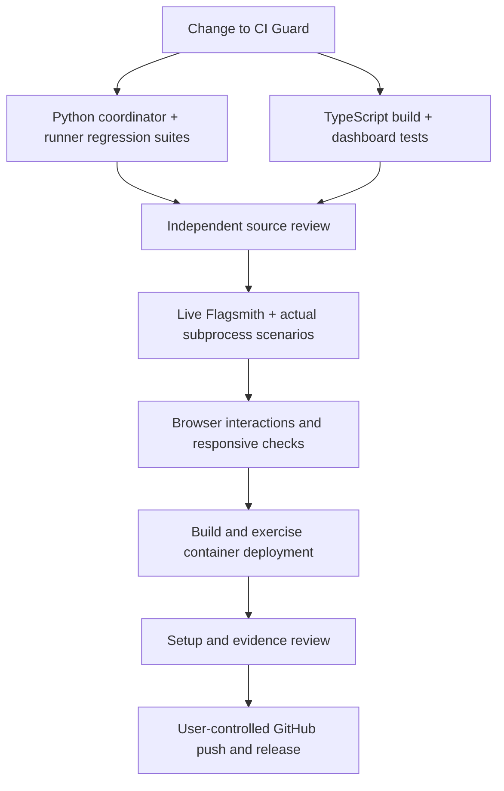

# CI Guard system map

Flagsmith stores policy. The coordinator stores operational state. The runner executes the actual tests. The dashboard presents recorded evidence. None of these components turns a blocked test into a successful required check.

The detailed [architecture and workflow design](superpowers/specs/2026-11-21-ci-guard-design.md) defines policy semantics, state transitions, concurrency, HTTP contracts, UI design, authentication, and verification. [Operations](OPERATIONS.md) covers setup, credentials, recovery and backup. [Verification](VERIFICATION.md) records observed results and external checks not yet performed.

## Release pipeline

The supplied `CI Guard checks` workflow runs the Python and UI checks on pushes and pull requests. The manual `Controlled CI Guard demonstration` workflow creates a temporary Flagsmith deployment and runs four concurrent clients inside one job. It is a local concurrency demonstration, not evidence that four separate GitHub-hosted runner machines were tested.
