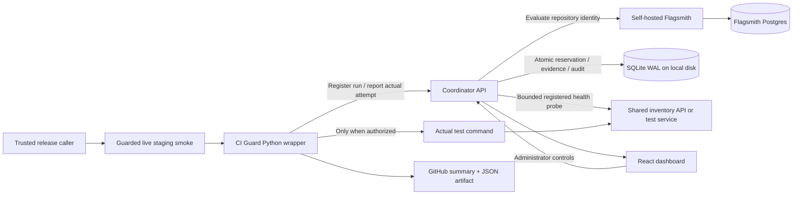
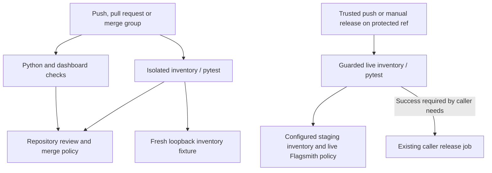

# CI Guard system map

Flagsmith stores policy. The coordinator stores operational state. The runner executes the actual tests. The dashboard presents recorded evidence. None of these components turns a blocked test into a successful required check.

The detailed [architecture and workflow design](superpowers/specs/2026-11-21-ci-guard-design.md) defines policy semantics, state transitions, concurrency, HTTP contracts, UI design, authentication, and verification. [Operations](OPERATIONS.md) covers setup, credentials, recovery and backup. [Verification](VERIFICATION.md) records observed results and external checks not yet performed.

## Independent verification and release gates

The isolated job needs no project token, coordinator or deployed dependency. Only the reusable release smoke receives a scoped token. The same inventory test expects deterministic `stock: 42` from staging; a different service needs an explicit test adaptation. An actual passing test, recorded execution evidence and the expected live policy are all required. Missing or failed evidence, including a successful one-off test on an errored Flagsmith policy, does not qualify. Deploying remains the caller’s responsibility; these workflows do not configure branch rules, grant secrets, or deploy anything.

The manual `Controlled CI Guard demonstration` workflow remains separate. Its [recorded GitHub run](GITHUB_VERIFICATION.md) created disposable services and used four concurrent clients within one job; it is not evidence of the new release smoke, production behavior, or four separate runner machines. See the [GitHub setup and call example](GITHUB.md#github-checks-and-release-smoke) for where to set a required check and how to keep the release path separate from PR checks and provider contract validation.
