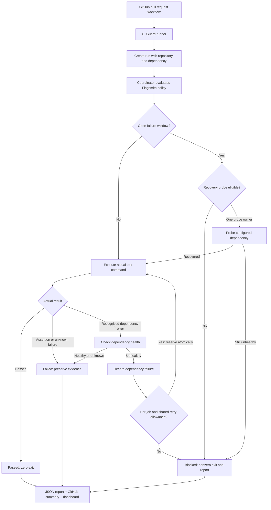

# CI Guard — architecture and design

## Intent and approaches
Implement the user's full CI Guard brief. A runner-only retry action cannot coordinate jobs. A GitHub App adds installation/OAuth overhead that is unnecessary for the requested action. Chosen implementation: a reusable action and Python CLI backed by one self-hosted coordinator, with a dashboard and self-hosted Flagsmith. This is an implementation choice under the user's build authorization.

## Components
- `server/ci_guard/`: FastAPI, sqlite3 WAL database, atomically reserved retry allowances, scoped API authentication, dashboard read APIs.
- `runner/ci_guard_runner/`: Python CLI using httpx; launches argv commands without shell interpolation; bounded output, timeout, explicit classification, report generation.
- `action.yml`: composite GitHub Action installing the runner and preserving its exit status while writing a summary.
- `web/`: React, TypeScript, Vite, lucide icons, responsive CSS, SVG charts using actual API series.
- `infra/`: Docker deployment and Flagsmith initialization. Root scripts bootstrap a local virtualenv and demo.
- `examples/`: pytest application and controllable inventory dependency for concurrent reproducible demonstrations.

## Deployment
One coordinator process/replica with a persistent SQLite database on local disk. SQLite BEGIN IMMEDIATE transactions serialize budget decisions and unique idempotency keys prevent duplicate spending. Tests use temporary databases. API and dashboard share an origin in Docker; Vite proxies `/api` during development. Internal services: self-hosted Flagsmith, its Postgres database, coordinator/dashboard, example inventory service. Exposed ports configurable; defaults dashboard/API 8080 and Flagsmith 8000.

## Runtime flow

## Policy and state semantics
Policy defaults: mode observe, max_job_retries 2, shared_dependency_retry_budget 2, dependency_cooldown_seconds 30. Values bounded and validated. Modes off/observe/enforce. Repository identity is `repo:<owner>/<name>` with repository and team traits. Evaluate a complete Flagsmith flag response once per decision; record source and fingerprint. In live mode no silent fabricated Flagsmith policy: on unavailable/invalid policy, run one attempt without retry and record policy error (availability without false success). In local demo use explicit `CI_GUARD_DEMO_MODE=true`, visibly labeled.

The coordinator stores per-dependency failure window, retries reserved, health evidence, opened_at, next_probe_at, and recovery-probe lease. Initial attempts are not retries. A job in a confirmed open outage may be blocked before its first attempt, but cannot report passed. Reservations are consumed when issued and are not refunded after client crashes; this prevents duplicated attempts. Failure windows reset only after an eligible successful health probe, not merely elapsed time. Unknown health does not justify blocking a new command, but no infrastructure retry is granted from inconclusive evidence. For half-open recovery only one job receives the probe lease; other jobs exit blocked promptly. A run's policy snapshot and decisions are immutable audit evidence; policy changes affect subsequent decisions, not historical reports.

Observe follows configured per-job retries for recognized dependency errors, tracks shadow budget and would-block decisions, never counts them as prevented. Enforce uses actual reservations. Off executes once. Mode transitions must not let observe consume enforce allowances; retain mode-specific counters in one persistent outage generation; mode switches never replenish either counter. Recovery clears both only on an actual healthy probe with a valid generation and lease. Different repository budgets share one pool whose active cap can only tighten until verified recovery.

## Shared HTTP contract v1
Runner requests use CI_GUARD_TOKEN; administrative writes and manual probes require CI_GUARD_ADMIN_TOKEN. Every authenticated request uses `Authorization: Bearer <token>`; local demo may omit it. JSON uses snake_case and UTC ISO-8601 timestamps. Errors `{detail: string}`. Dependency health URLs/patterns are configured by administrators, not arbitrary URLs accepted from an untrusted run.

- `GET /api/health` -> `{status: "ok", version: "1.0.0", demo_mode: boolean}`.
- `GET /api/overview` -> `{stats: {total_runs, passed_runs, failed_runs, blocked_runs, prevented_attempts, would_prevent_attempts, execution_seconds}, trend: [{date, attempts, prevented}], recent_runs: Run[], dependencies: Dependency[], policy: Policy, demo_mode, policy_source}`.
- `GET /api/runs?status=&repository=&search=&limit=50` -> `Run[]`.
- `GET /api/runs/{id}` -> `Run` with `attempts` and `decisions`.
- `POST /api/runs` body `{repository, dependency, job_id, workflow_run_id?, command?, idempotency_key?}` -> `Run` containing `id`, policy and initial `decision`.
- `POST /api/runs/{id}/attempts` body `{idempotency_key, attempt_number, exit_code, duration_seconds, classification: passed|assertion|dependency|unknown|timeout, evidence?, health_status: healthy|unhealthy|unknown, health_detail?}` -> `{run: Run, decision: Decision}`. The first attempt follows the initial decision; next attempts require `retry` decision. Duplicate request keys return the same result and do not spend another retry.
- `POST /api/runs/{id}/finish` body `{status: passed|failed|blocked|error|cancelled, reason?}` -> `Run`; passed requires a recorded successful attempt. A terminal run cannot be reopened.
- `GET /api/dependencies` -> `Dependency[]`; `POST /api/dependencies`/`PUT /api/dependencies/{id}` configure `{id,name,health_url,error_patterns,timeout_seconds=3}`. `POST /api/dependencies/{id}/probe` probes registered URLs with bounded timeout and no redirects. Admin-authenticated configuration permits private services intentionally; reject non-http schemes, credentials in URLs, cloud metadata endpoints, and control characters.
- `GET /api/policy?repository=` -> `Policy` plus source, fingerprint and error. `PUT /api/policy` body policy fields writes actual Flagsmith config in live mode if admin configuration exists; otherwise 409 actionable read-only error. Demo mode uses explicit persistent demo policy.
- `GET /api/settings` -> safe configuration status without secrets.
- `GET /api/audit` -> recent audit entries.
- `POST /api/demo/run` body `{scenario: outage|healthy|assertion, jobs: 4}` -> run actual example subprocesses, return run IDs/results; explicit demo mode only, bounded concurrency, asynchronous response if needed. No manufactured savings.

`Policy` fields: mode, max_job_retries, shared_dependency_retry_budget, dependency_cooldown_seconds, source, fingerprint, error (nullable).
`Decision`: action run|retry|block|stop|probe, reason, retry_after_seconds, shared_remaining, would_block, policy.
`Dependency`: id, name, health_url, error_patterns (literal error signatures), timeout_seconds, status healthy|unhealthy|unknown, retries_used, budget, next_probe_at, last_checked_at, active_runs.
`Run`: id, repository, dependency, job_id, workflow_run_id, status queued|running|passed|failed|blocked|error|cancelled, created_at, finished_at, attempt_count, prevented_attempts, would_prevent_attempts, duration_seconds, reason, policy, decision, demo (boolean).

## Runner behavior
CLI: `ci-guard run --server URL --repository owner/repo --dependency inventory-api --job-id ID --report ci-guard-report.json --timeout 120 -- <argv...>`; token only from CI_GUARD_TOKEN. Fetch registered dependency and initial decision. Probe via coordinator endpoint if instructed. For each executed command capture bounded stdout/stderr, timeout and elapsed monotonic time. Recognize dependency errors only from configured literal signatures. Direct pytest invocations load a structured adapter: actual exception values supply classification evidence, assertion/unknown failures override dependency failures, and at least one passed test call is required for success. All-skipped, all-expected-failure, empty and collection-only suites cannot pass the gate. Generic commands explicitly report process-exit verification without claiming individual test outcomes. Unknown and assertion results never retried. API failures stop retries; an actual nonzero test result never becomes success. Signals terminate child process group, record cancellation when possible, and always write best-effort report. Streaming redaction precedes bounded output capture so truncated secrets cannot leak as token fragments. No sleep until dependency recovery. Exit: 0 verified pytest success or successful generic command exit; 1 failed tests/command; 2 blocked; 3 configuration/coordination error; 124 test timeout. GitHub wrapper propagates this code; configure required check with no `continue-on-error` and no conditional skipped success gate.

## UI and interaction
Desktop layout follows supplied references: warm-to-cool outer wash, large pale shell, white pill header/navigation, oversized heading, rounded white cards, dark green/black selected states, blue/pink/green accents. No copied logos or unrelated decorative avatars. Left icon navigation with accessible labels; Overview/Runs/Dependencies/Policies/Settings. Dashboard: actual run totals, prevented attempts, execution time, attempt trend, outcome ring, dependency health, recent runs. Runs: filtering/search and detail drawer with evidence, attempts, policy, downloadable JSON. Dependencies: health probe, creation/edit dialog, shared-budget meters, cooldown state. Policies: live source, mode segmented control, numeric budgets, repository policy preview; save requires confirmed server response. Settings: connection status, installation YAML copy, token input kept in memory/session storage and not URL/localStorage, operational instructions.

Empty, loading, error, disconnected, unauthorized, demo and successful states explicit. No fabricated metrics, percentages, or savings. Responsive 1440/1024/768/390 widths, keyboard interactions, focus management in dialogs, focus outlines, semantic headings, accessible chart summaries, reduced-motion preference. Motion limited to 140–200ms opacity/transform and real request feedback.

## Security and operation
Single organization trust boundary; production requires strong configured token, HTTPS at reverse proxy and private network access for dependency endpoints. Browser gets no Flagsmith admin/server secret. API validates bounded payloads and URLs. Reports contain sanitized bounded evidence, not whole logs or environment dumps. Shell commands are argv arrays; arbitrary commands are deliberate local CI configuration, never accepted from dashboard users. SQLite local-disk single coordinator constraint documented. Backups include the DB and configuration. Readiness and liveness distinct. Database schema versioning/migrations required before changing existing schemas.

## Verification
Unit/contract tests for policy parsing, classification, exits, summaries, and auth. Real SQLite concurrency tests with duplicate requests, simultaneous budget reservations, recovery lease and mode changes. Actual subprocess runner tests. Integration with self-hosted Flagsmith, policy targeting, and update propagation. Controlled concurrent observe/enforce runs, assertion-failure and recovery paths. Browser tests for navigation/filter/detail/settings/policy/probe and small screen. Docker config/build/start health. GitHub-hosted execution and required-check branch protection must be reported unverified unless actually exercised with repository credentials and a remote workflow.
